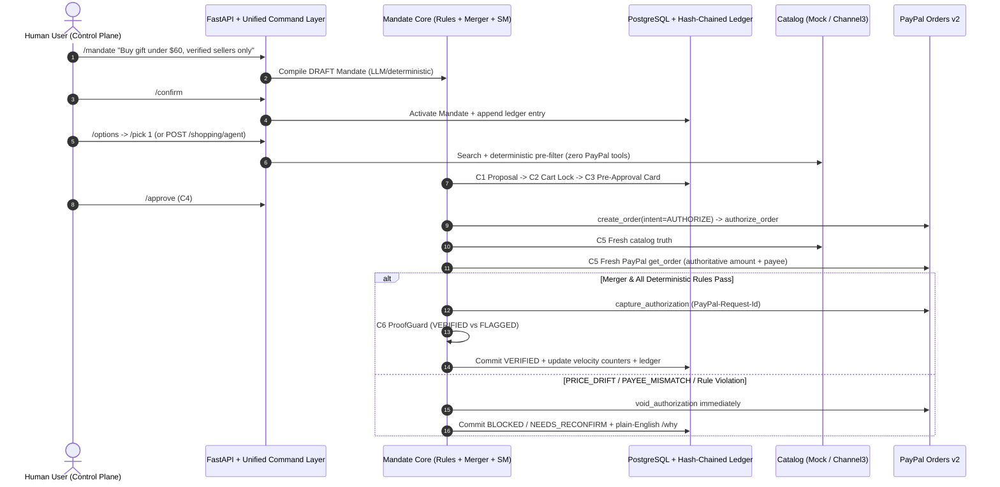

# Mandate — Autonomous AI Agent Spending Firewall for PayPal

> **AI agents can spend your money. Mandate makes sure they only spend it the way you said, and proves it.**

[](LICENSE)
[](https://www.python.org/)
[](https://fastapi.tiangolo.com/)
[](https://developer.paypal.com/)

---

## 1. The Problem & Why Mandate Matters

When an AI shopping agent calls a payment API, traditional payment rails only verify *who holds the API credential*—not whether the purchase honored human intent (*"Buy a gift under $60, verified sellers only"*). If product descriptions contain prompt injections, prices drift mid-checkout, or a seller swaps the PayPal payee behind the scenes, raw payment APIs blindly settle the charge.

**Mandate** places a deterministic, cryptographically auditable control layer between AI agents and money movement:

- **Mandate Core (`packages/core/mandate_core`)** — A strictly isolated, domain-agnostic policy & state-machine package (zero imports from `adapters/` or `apps/`). It manages Mandates, Proposals, Cases, Snapshots, Findings, Decisions, Checkpoints (`C1–C8`), a SHA-256 hash-chained Ledger, and a unified pre-LLM Command Layer.
- **Mandate Shop Backend (`apps/api` + `adapters/`)** — A FastAPI + Pydantic v2 service backed by PostgreSQL (`asyncpg` with `SELECT ... FOR UPDATE SKIP LOCKED` & `pg_advisory_xact_lock`, plus SQLite parity for zero-config local runs), PayPal Orders v2 (`paypal-agent-toolkit`), dual Catalog adapters (`MockCatalog` & `Channel3Catalog`), advisory LLMs (`Gemini 3.8 Flash` & `Groq`), and a 9-scenario Red-Team Demo Lab (`R1–R9`).

---

## 2. Core Architectural Laws

1. **The LLM never enforces anything**: LLM outputs are schema-validated data only; deterministic Python code executes every allow/block decision.
2. **The LLM can only tighten, never loosen**: The advisory AI Auditor returns `{verdict: "ok"|"flag"|"block", reasons[]}`; timeouts or errors escalate to `flag`, never `ok`.
3. **Control plane vs. data plane**: A deterministic `/` slash-command parser executes *before* any LLM call. Product descriptions, catalog metadata, and agent outputs are treated as untrusted data and are structurally blocked from triggering commands.
4. **Fail closed**: Timeouts, missing data, or upstream errors equal *not approved*.
5. **Atomic state + ledger**: Every state change, checkpoint (`C1–C8`), and illegal transition attempt writes a SHA-256 hash-chained `ledger_entries` row in the same DB transaction.
6. **Exact money arithmetic**: `Decimal` + uppercase ISO-4217 currency everywhere (`Money` raises `TypeError` on `float`).
7. **Idempotency everywhere**: `PayPal-Request-Id` on every mutating PayPal call; webhook deduplication by `event_id`.
8. **One code path**: UI approval buttons and chat `/` commands invoke the exact same `Orchestrator` handlers.
9. **Core reusability**: `mandate_core` has zero imports from `adapters/` or `apps/` (enforced in CI via AST test), proven live with a second non-shopping **Email Agent Policy Pack** (`POST /packs/email/check`).

---

## 3. Architecture & Checkpoint Flow (`C1–C8`)



### State Machines & Checkpoints

- **Mandate Lifecycle**: `DRAFT → ACTIVE → (REVOKED | EXPIRED)`. `/amend <field> <value>` creates an incremented version requiring `/confirm`, while retaining prior versions in the database and ledger.
- **Case Lifecycle**: `PROPOSED → CART_LOCKED → CHECKED → AWAITING_APPROVAL → APPROVED → AUTHORIZED → CAPTURED → VERIFIED`, with side states `HELD`, `CANCELLED`, `BLOCKED`, `NEEDS_RECONFIRM`, `EXPIRED`, `FLAGGED`.
- **Checkpoints**:
  - `C1` Proposal ingestion | `C2` Cart lock | `C3` Pre-approval card check
  - `C4` Approve click recheck | `C5` Pre-capture final gate (`void` on fail) | `C6` Post-capture `ProofGuard`
  - `C7` Background `recheck_jobs` sweep every 30s (`SELECT ... FOR UPDATE SKIP LOCKED`) | `C8` Webhook dedup + reconcile

---

## 4. Repository Layout

```text
mandate/
├── packages/core/mandate_core/      # Strictly isolated domain-agnostic engine
│   ├── domain/                      # Money (Decimal), Mandate, Proposal, Case, Finding, Snapshot
│   ├── rules/                       # @register_rule registry + shopping & email packs (JSON)
│   ├── merger/                      # build_snapshot, diff, conflict codes, plain-English /why
│   ├── statemachine/                # Transitions, StateStore protocol, Orchestrator (C1-C8)
│   ├── ledger/                      # Canonical SHA-256 hash chain, verify, Agent Trust Score
│   ├── recheck/                     # Checkpoints, DriftDetector, ProofGuard, AI Auditor
│   ├── commands/                    # Pre-LLM slash parser & unified CommandRegistry
│   ├── workflows/                   # Mandate Compiler, ask_preference, 2-tool Shopping Agent
│   └── ports/                       # Abstract Protocols: PaymentProvider, Catalog, LLM, Notifier
├── adapters/
│   ├── persistence/                 # SQLAlchemy async Postgres (advisory locks/SKIP LOCKED) & SQLite
│   ├── paypal/                      # PayPal Orders v2 + paypal-agent-toolkit + MockPayPalProvider
│   ├── catalog_mock/                # 40 seeded items (Seller A & Seller B) + admin price bump
│   ├── catalog_channel3/            # Channel3 SDK adapter mapped to Core Product schema
│   ├── llm_gemini/                  # Google Gemini 3.8 Flash (temperature=0, JSON schema + tools)
│   ├── llm_groq/                    # Groq Llama 3.3 70B backup adapter
│   └── notifier_console/            # Console recorder & Zapier/Slack WebhookNotifier
├── apps/api/                        # FastAPI service, Pydantic schemas, routers, background worker
├── docs/                            # architecture.md, openapi.json, mandate-postman-collection.json
├── tests/                           # Unit, Hypothesis property, contract, DB tamper & R1-R9 E2E
├── Dockerfile / docker-compose.yml / render.yaml
└── scripts/export_postman.py        # Exports OpenAPI 3.1 + Postman v2.1 collection
```

---

## 5. Quick Start (< 5 Minutes)

### Option A: Local Python (Zero-Config SQLite & Mock Sandbox)

Requires **Python 3.11+** (tested on Python 3.14 & 3.12):

```bash
# 1. Create and activate virtual environment
python3 -m venv .venv
source .venv/bin/activate

# 2. Install backend, core, and test dependencies
pip install -e ".[dev]"
pip install --no-deps paypal-agent-toolkit

# 3. Copy environment template
cp .env.example .env

# 4. Run full lint & test suite (unit + Hypothesis + integration + R1-R9 E2E)
ruff check packages adapters apps tests scripts
pytest -v

# 5. Start the FastAPI server
uvicorn apps.api.main:app --reload --port 8000
```

Open **`http://localhost:8000/docs`** for interactive Swagger UI or **`http://localhost:8000/openapi.json`**.

### Option B: Docker Compose (PostgreSQL 16 + FastAPI)

```bash
docker compose up --build
```

### Option C: Render Cloud Deployment

Deploy via [`render.yaml`](render.yaml) (provisions `mandate-api` web service + `mandate-db` managed PostgreSQL; `postgres://` connection strings are automatically normalized for `asyncpg`).

---

## 6. Environment Configuration

See [`.env.example`](.env.example) for the complete template:

| Variable | Default | Description |
|---|---|---|
| `DATABASE_URL` | `sqlite+aiosqlite:///./data/mandate.db` | Use `postgresql+asyncpg://...` (or Render `postgres://...`) in production |
| `REQUIRE_AUTH` | `false` | Set `true` to enforce Bearer / `x-api-key` auth on protected endpoints |
| `API_ADMIN_TOKEN` / `API_USER_TOKEN` | dev tokens | Constant-time verified tokens when `REQUIRE_AUTH=true` |
| `PAYPAL_MODE` | `mock` | `mock` \| `sandbox` \| `live` |
| `PAYPAL_CLIENT_ID` / `PAYPAL_CLIENT_SECRET` | `""` | PayPal REST Sandbox/Live credentials |
| `PAYPAL_WEBHOOK_ID` | `""` | PayPal webhook ID for `/webhooks/paypal` signature verification |
| `PAYPAL_SANDBOX_SELLER_A_ID` / `SELLER_B_ID` | `SELLER-A-VERIFIED` / `SELLER-B-ATTACKER` | Seller A (approved) & Seller B (wrong-payee red-team) |
| `LLM_PROVIDER` | `gemini` | `gemini` \| `groq` \| `deterministic` |
| `GEMINI_API_KEY` / `GEMINI_MODEL` | `""` / `gemini-3.8-flash` | Google AI Studio key (`gemini-3.8-flash` upgrades legacy 2.0/2.5 Flash) |
| `GROQ_API_KEY` / `GROQ_MODEL` | `""` / `llama-3.3-70b-versatile` | Backup LLM provider |
| `CATALOG_PROVIDER` | `mock` | `mock` \| `channel3` |
| `CHANNEL3_API_KEY` | `""` | Channel3 product search SDK key |
| `NOTIFIER_PROVIDER` / `ZAPIER_WEBHOOK_URL` | `console` / `""` | Console/memory or Zapier/Slack webhook notifications |
| `RECHECK_POLL_INTERVAL_SECONDS` | `30` | Background C7 `recheck_jobs` sweep interval |

---

## 7. API Endpoints, Frontend Contract & Slash Commands

### Frontend Integration (`openapi-typescript` & AG Grid)
- Static OpenAPI 3.1 spec is exported to [`docs/openapi.json`](docs/openapi.json) alongside [`docs/mandate-postman-collection.json`](docs/mandate-postman-collection.json). Regenerate anytime with `python scripts/export_postman.py`.
- Generate frontend TypeScript types directly:
  ```bash
  npx openapi-typescript docs/openapi.json -o src/types/mandate-api.ts
  ```
- AG Grid Server-Side Row Model connects directly to `GET /ledger?startRow=0&endRow=50&sortDir=desc`.

### Endpoints Summary

| Group | Endpoints | Purpose |
|---|---|---|
| **Health** | `GET /health`, `GET /ready` | Liveness & active adapter readiness |
| **Control Plane** | `POST /commands` | Pre-LLM `/` command dispatcher + untrusted source guard |
| **Mandates** | `POST /mandates/compile`, `POST /mandates/{id}/confirm`, `POST /mandates/{id}/amend`, `POST /mandates/revoke`, `GET /mandates`, `GET /mandates/{id}` | Compile draft, confirm, versioned amend, kill switch |
| **Shopping & Catalog** | `GET /catalog/search`, `GET /catalog/{id}`, `POST /shopping/options`, `POST /shopping/agent`, `POST /shopping/pick`, `POST /admin/catalog/{id}/price`, `POST /admin/catalog/{id}/stock` | Search, `ask_preference` ranking, 2-tool agent, cart lock, price bump |
| **Cases & Recheck** | `POST /cases/propose`, `POST /cases/{id}/lock`, `POST /cases/{id}/approve`, `POST /cases/{id}/approve-only`, `POST /cases/{id}/authorize-only`, `POST /cases/{id}/capture-only`, `POST /cases/{id}/hold`, `POST /cases/{id}/resume`, `POST /cases/{id}/cancel`, `POST /cases/{id}/recheck`, `GET /cases/{id}/why`, `GET /cases/{id}/snapshots`, `GET /cases/{id}/diff` | Full state machine, PayPal JS split or 1-click capture, plain-English `/why`, snapshot diffs |
| **Ledger & Trust** | `GET /ledger`, `GET /ledger/verify`, `GET /ledger/trust-score` | AG Grid rows, SHA-256 chain tamper detector, Agent Trust Score |
| **Webhooks** | `POST /webhooks/paypal` | Signature verification, `event_id` dedup, C8 reconcile queue |
| **Demo Lab & Packs** | `POST /demo-lab/run/{R1..R9}`, `POST /demo-lab/tamper-ledger/{seq}`, `POST /demo-lab/reset`, `POST /packs/email/check` | Live red-team attacks & domain-agnostic Email Agent policy pack |

### Supported `/` Slash Commands
`/mandate <text>` · `/mandate show` · `/confirm` · `/amend <field> <value>` · `/options` · `/pick <n>` · `/approve [id]` · `/cancel [id]` · `/hold [dur]` · `/resume [id]` · `/recheck [id]` · `/status [id]` · `/why [id]` · `/ledger [n]` · `/revoke` · `/help`

---

## 8. Judge Demo Walkthrough (Under 3 Minutes)

1. **Happy Path (`VERIFIED`)**:
   ```bash
   # 1. Compile & confirm mandate
   curl -s -X POST http://localhost:8000/commands -H "Content-Type: application/json" \
     -d '{"text":"/mandate Buy birthday gift under $60, verified sellers only"}'
   curl -s -X POST http://localhost:8000/commands -H "Content-Type: application/json" \
     -d '{"text":"/confirm"}'

   # 2. Search pre-filtered options, pick #1, approve & verify with ProofGuard
   curl -s -X POST http://localhost:8000/commands -H "Content-Type: application/json" \
     -d '{"text":"/options"}'
   curl -s -X POST http://localhost:8000/commands -H "Content-Type: application/json" \
     -d '{"text":"/pick 1"}'
   curl -s -X POST http://localhost:8000/commands -H "Content-Type: application/json" \
     -d '{"text":"/approve"}'
   ```
2. **Red-Team Demo Lab (`R1–R9`)**:
   - `POST /demo-lab/run/R1`: Overspend blocked (`EXCEEDS_MAX_TOTAL`)
   - `POST /demo-lab/run/R2`: Unverified Seller B blocked (`UNVERIFIED_SELLER`)
   - `POST /demo-lab/run/R3`: Payee swapped mid-checkout → C5 catches `PAYEE_MISMATCH` and **immediately voids** PayPal authorization
   - `POST /demo-lab/run/R4`: Price bumped during `/hold` → C7 catches `PRICE_DRIFT` and moves to `NEEDS_RECONFIRM`
   - `POST /demo-lab/run/R5`: Expired mandate blocked
   - `POST /demo-lab/run/R6`: Prompt injection `/approve` in product description blocked at control-plane boundary + heuristic/AI Auditor
   - `POST /demo-lab/run/R7`: Duplicate webhook safely deduplicated
   - `POST /demo-lab/run/R8`: Kill switch `/revoke` freezes mandates, cancels open cases, voids holds
   - `POST /demo-lab/run/R9`: Mutates a DB ledger row directly and runs `GET /ledger/verify` — pinpoints the exact broken `seq`
3. **Core Reusability Proof**: `POST /packs/email/check` evaluates `max_recipients` and `allowlist_domain` using the exact same `mandate_core` Rule Engine + hash-chained Ledger.

---

## 9. Honest Sandbox vs. Synthetic Disclosure

- **Real integrations (active when keys/infra are supplied)**:
  - **PayPal Orders v2 Sandbox/Live** via `PayPalPaymentProvider` & `paypal-agent-toolkit` (`PAYPAL_MODE=sandbox|live`).
  - **Google Gemini (`gemini-3.8-flash`)** via `google-genai` Interactions API & **Groq (`llama-3.3-70b-versatile`)** via `groq`.
  - **Channel3 Catalog** via `channel3-sdk` (`CATALOG_PROVIDER=channel3`).
  - **PostgreSQL** (`asyncpg`, `JSONB`, `SELECT ... FOR UPDATE SKIP LOCKED`, `pg_advisory_xact_lock`).
- **Deterministic local/synthetic fallbacks (active out-of-the-box without credentials)**:
  - `MockPayPalProvider`, 40-item `MockCatalog`, deterministic regex compiler/2-tool shopping fallback, and `sqlite+aiosqlite` local parity.
