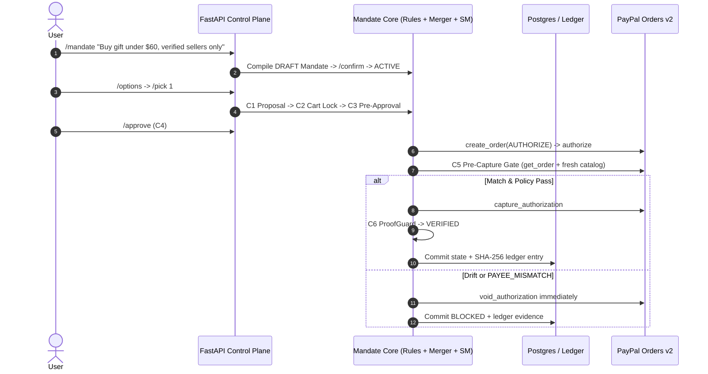

# Mandate — Autonomous AI Agent Spending Firewall

> **AI agents can spend your money. Mandate makes sure they only spend it the way you said, and proves it.**

[](LICENSE)
[](https://www.python.org/)
[](https://fastapi.tiangolo.com/)

---

## 1. What Mandate Builds

- **Mandate Core (`packages/core/mandate_core`)**: A strictly isolated, domain-agnostic control engine with zero imports from `adapters/` or `apps/`. It manages Mandates, Proposals, Cases, Snapshots, Findings, Decisions, Checkpoints (`C1–C8`), a SHA-256 hash-chained Ledger, and a unified pre-LLM Command Layer.
- **Mandate Shop Backend (`apps/api` + `adapters/`)**: FastAPI REST service, PostgreSQL (`asyncpg` with `SELECT ... FOR UPDATE SKIP LOCKED` & `pg_advisory_xact_lock`, plus SQLite local parity), PayPal Orders v2 (`paypal-agent-toolkit`), Catalog (`MockCatalog` & `Channel3Catalog`), Advisory LLMs (`Gemini 3.8 Flash` via `google-genai` & `Groq`), Notifier, and Red-Team Demo Lab (`R1–R9`).

---

## 2. Core Architectural Laws

1. **LLM never enforces anything**: LLM outputs are schema-validated data only; deterministic Python code makes every allow/block decision.
2. **LLM can only tighten, never loosen**: The advisory AI Auditor emits `{verdict: "ok"|"flag"|"block", reasons[]}`; timeouts escalate to `flag`.
3. **Control plane vs. data plane**: Deterministic `/` parser runs *before* any LLM call; untrusted product descriptions and agent outputs can never invoke commands.
4. **Fail closed**: Timeouts, missing data, or upstream errors are never approved.
5. **Atomic state + ledger**: Every state transition, checkpoint, and illegal transition attempt writes a hash-chained `ledger_entries` row inside the same DB transaction.
6. **Exact money**: `Decimal` + ISO-4217 currency everywhere—`float` is rejected at runtime.
7. **Idempotency everywhere**: `PayPal-Request-Id` on every mutating PayPal call; webhook deduplication by `event_id`.
8. **One code path**: Chat `/` commands and UI REST endpoints call the exact same `Orchestrator` handlers.

---

## 3. Architecture



---

## 4. Quick Setup (< 10 Minutes)

### Local Python Setup (Zero-Config SQLite or Postgres)

```bash
# 1. Create virtualenv (Python 3.11 / 3.12 recommended)
python3.12 -m venv .venv
source .venv/bin/activate

# 2. Install backend + core + dev test tools
pip install -e ".[dev]"
pip install --no-deps paypal-agent-toolkit

# 3. Configure environment
cp .env.example .env

# 4. Run tests (unit + Hypothesis property tests + integration + R1-R9 E2E)
pytest -v

# 5. Start API server (OpenAPI docs at http://localhost:8000/docs)
uvicorn apps.api.main:app --reload --port 8000
```

### Docker Compose (Postgres 16 + FastAPI API)

```bash
docker compose up --build
```

### Render Deployment

Use [`render.yaml`](render.yaml) to provision the FastAPI web service (`mandate-api`) and managed PostgreSQL database (`mandate-db`).

---

## 5. Environment Variables

| Variable | Default | Purpose |
|---|---|---|
| `DATABASE_URL` | `sqlite+aiosqlite:///./data/mandate.db` | Use `postgresql+asyncpg://...` in Docker/Render |
| `PAYPAL_MODE` | `mock` | `mock` \| `sandbox` \| `live` |
| `PAYPAL_CLIENT_ID` / `PAYPAL_CLIENT_SECRET` | `""` | PayPal Sandbox/Live REST credentials |
| `PAYPAL_WEBHOOK_ID` | `""` | PayPal webhook ID for signature verification |
| `LLM_PROVIDER` | `gemini` | `gemini` \| `groq` \| `deterministic` |
| `GEMINI_API_KEY` / `GEMINI_MODEL` | `""` / `gemini-3.8-flash` | Google AI Studio key (`gemini-3.8-flash` replaces legacy 2.0/2.5 Flash) |
| `GROQ_API_KEY` / `GROQ_MODEL` | `""` / `llama-3.3-70b-versatile` | Fallback LLM provider |
| `CATALOG_PROVIDER` | `mock` | `mock` \| `channel3` |
| `CHANNEL3_API_KEY` | `""` | Channel3 product search SDK key |
| `RECHECK_POLL_INTERVAL_SECONDS` | `30` | Background C7 `recheck_jobs` sweep interval |

---

## 6. Key API Endpoints & Slash Commands

- **OpenAPI 3.1 & Swagger**: `GET /openapi.json`, `GET /docs` (and exported Postman collection in [`docs/mandate-postman-collection.json`](docs/mandate-postman-collection.json)).
- **Command Layer (`POST /commands`)**: `/mandate <text>`, `/mandate show`, `/confirm`, `/amend <field> <value>`, `/options`, `/pick <n>`, `/approve`, `/cancel`, `/hold [dur]`, `/resume`, `/recheck [id]`, `/status [id]`, `/why [id]`, `/ledger [n]`, `/revoke`, `/help`.
- **Ledger & AG Grid**: `GET /ledger` (`startRow`, `endRow`, `sortDir`), `GET /ledger/verify`, `GET /ledger/trust-score`.
- **Demo Lab (`POST /demo-lab/run/{R1..R9}`)**:
  - `R1` Overspend, `R2` Unverified seller, `R3` Payee mismatch mid-checkout (`VOID`), `R4` Price drift during hold (`NEEDS_RECONFIRM`), `R5` Expired mandate, `R6` Prompt injection in product description, `R7` Duplicate webhook dedup, `R8` Kill switch `/revoke`, `R9` Ledger tamper + `/ledger/verify` detection.
- **Second Policy Pack (`POST /packs/email/check`)**: Proves Core reusability on an autonomous email-sending agent (`max_recipients`, `allowlist_domain`).

---

## 7. Honest Sandbox vs. Synthetic Disclosure

- **Real when configured with keys/infra**: PayPal Orders v2 Sandbox REST + `paypal-agent-toolkit` (`PAYPAL_MODE=sandbox`), Google Gemini `gemini-3.8-flash` via `google-genai`, Groq `llama-3.3-70b-versatile`, Channel3 catalog API via `channel3-sdk`, and PostgreSQL `SELECT ... FOR UPDATE SKIP LOCKED` + `pg_advisory_xact_lock`.
- **Local/Synthetic fallbacks for zero-dependency demos & CI**: `MockPayPalProvider`, `MockCatalog` (40 seeded Seller A/B items), deterministic regex Intent Compiler fallback, and SQLite async parity when PostgreSQL is not running locally.
