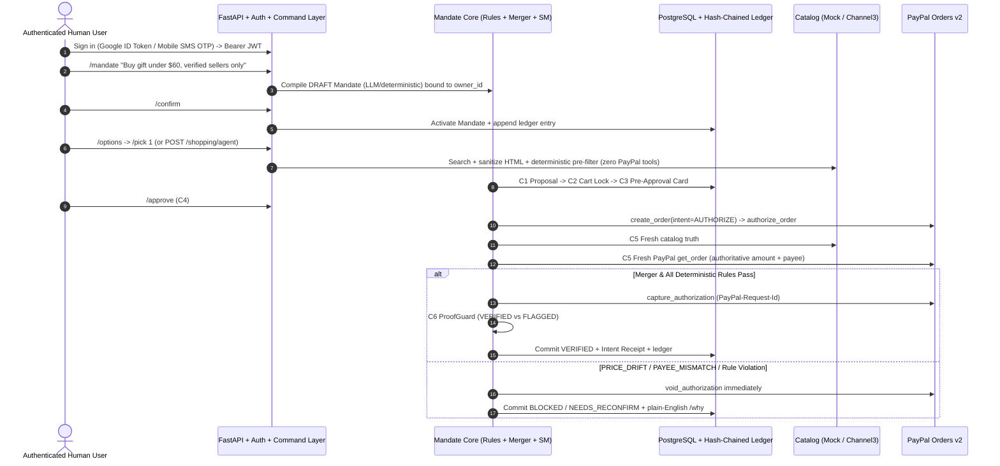

# Mandate — Autonomous AI Agent Spending Firewall for PayPal

> **AI agents can spend your money. Mandate makes sure they only spend it the way you said, and proves it.**

[](LICENSE)
[](https://www.python.org/)
[](https://fastapi.tiangolo.com/)
[](https://developer.paypal.com/)

---

## 1. The Problem & Why Mandate Exists

When an AI shopping agent calls a payment API, standard payment rails only verify *who holds the API key* — not whether the transaction honored human intent (*"Buy a gift under $60, verified sellers only"*). If product pages contain hidden HTML/CSS prompt injections, merchant prices drift mid-checkout, or an attacker swaps the PayPal payee behind the scenes, raw payment APIs blindly settle the charge.

**Mandate** sits between autonomous agents and money movement as a deterministic, cryptographically auditable spending firewall:

- **Mandate Core (`packages/core/mandate_core`)** — Strictly isolated, domain-agnostic policy and state-machine engine (zero imports from `adapters/` or `apps/`, enforced by AST tests). Manages Mandates, Proposals, Cases, Snapshots, Findings, Decisions, Checkpoints (`C1–C8`), a SHA-256 hash-chained Ledger, canonical **Intent Receipts**, HTML/CSS prompt-injection sanitization, and the pre-LLM Command Layer.
- **Mandate Production API (`apps/api` + `adapters/`)** — FastAPI + Pydantic v2 backend backed by PostgreSQL (`asyncpg`, `SELECT ... FOR UPDATE SKIP LOCKED`, `pg_advisory_xact_lock`) and SQLite parity, **Google OAuth + Mobile SMS OTP session authentication**, strict per-user tenant isolation, secret redaction, PayPal Orders v2 (`paypal-agent-toolkit`), Channel3 & Mock catalogs, advisory LLMs (`Gemini 3.6 Flash`, `Groq`, `Astropods`), Kernel cloud browser URL verification, Elastic hybrid search, Render Workflows, and a 13-scenario Red-Team Demo Lab (`R1–R13`).

---

## 2. Core Architectural & Security Guarantees

1. **The LLM never enforces anything**: LLM outputs are schema-validated data only; deterministic Python executes every allow/block decision.
2. **The LLM can only tighten, never loosen**: The advisory AI Auditor returns `{verdict: "ok"|"flag"|"block", reasons[]}`; timeouts or malformed outputs fail closed to `flag`, never `ok`.
3. **Control plane vs. data plane + HTML/CSS sanitizer**: A deterministic `/` slash-command parser executes *before* any LLM call; hidden HTML/CSS (`display:none`, `opacity:0`, `visibility:hidden`, `!important`, comments, `<script>`) is stripped before model context ingestion, and untrusted product/agent inputs cannot trigger commands.
4. **Strict Per-User Tenant Isolation**: Authenticated Google / Mobile OTP users (`usr_*`) can only read, amend, approve, cancel, revoke, search, or inspect **their own** mandates, cases, snapshots, receipts, shopping options, and audit ledger entries (`403 FORBIDDEN` on cross-user access).
5. **Production Fail-Closed Security Posture**:
   - In `APP_ENV=production`, demo Google sign-in and inline OTP exposure are automatically disabled, and startup fails fast if `REQUIRE_AUTH=true` is left with default dev secrets or short JWT keys.
   - SSRF-hardened merchant URL verification (public DNS resolution + IPv4/IPv6 private-range blocking + redirect-hop validation + response byte caps).
   - Automatic secret redaction (`redact_secrets`) strips API keys, Bearer tokens, Twilio SIDs, and database credentials from logs, health probes, and error responses.
   - Per-phone DB rate limiting + per-IP sliding-window throttling on SMS OTP requests/verifications.
6. **Atomic State + Cryptographic Audit Ledger**: Every state transition, checkpoint (`C1–C8`), sign-in event, and illegal transition attempt appends a SHA-256 hash-chained `ledger_entries` row in the same database transaction, paired with tamper-evident **Intent Receipts** (`GET /cases/{id}/receipt` & `/receipt`).
7. **Exact Money Arithmetic**: `Decimal` + uppercase ISO-417 currency everywhere (`Money` rejects `float` with `TypeError`).
8. **Idempotency Everywhere**: `PayPal-Request-Id` on every mutating PayPal call; webhook deduplication by `event_id`.

---

## 3. Architecture & Checkpoint Flow (`C1–C8`)



### State Machines & Checkpoints

- **Mandate Lifecycle**: `DRAFT -> ACTIVE -> (REVOKED | EXPIRED)`. `/amend <field> <value>` creates an incremented version requiring `/confirm`, while preserving prior versions in the database and ledger.
- **Case Lifecycle**: `PROPOSED -> CART_LOCKED -> CHECKED -> AWAITING_APPROVAL -> APPROVED -> AUTHORIZED -> CAPTURED -> VERIFIED`, with side states `HELD`, `CANCELLED`, `BLOCKED`, `NEEDS_RECONFIRM`, `EXPIRED`, `FLAGGED`.
- **Checkpoints**:
  - `C1` Proposal ingestion | `C2` Cart lock | `C3` Pre-approval card check
  - `C4` Approve click recheck | `C5` Pre-capture final gate (`void` on fail) | `C6` Post-capture `ProofGuard`
  - `C7` Background `recheck_jobs` sweep (`SELECT ... FOR UPDATE SKIP LOCKED`) | `C8` Webhook dedup + reconcile

---

## 4. Repository Layout

```text
mandate/
├── packages/core/mandate_core/      # Strictly isolated domain-agnostic engine
│   ├── domain/                      # Money (Decimal), Mandate, Proposal, Case, Findings, Errors
│   ├── rules/                       # @register_rule registry + shopping & email packs (JSON)
│   ├── merger/                      # build_snapshot, diff, conflict codes, plain-English /why
│   ├── statemachine/                # Transitions, StateStore protocol, Orchestrator (C1-C8)
│   ├── ledger/                      # Canonical SHA-256 hash chain, Intent Receipts, Trust Score
│   ├── recheck/                     # Checkpoints, DriftDetector, ProofGuard, AI Auditor
│   ├── commands/                    # Pre-LLM slash parser & unified CommandRegistry
│   ├── workflows/                   # Compiler, ask_preference, 2-tool Shopping Agent, HTML sanitizer
│   └── ports/                       # Abstract Protocols: PaymentProvider, Catalog, LLM, Notifier
├── adapters/
│   ├── auth/                        # HS256 JWT tokens, Google ID token verifier, Twilio SMS OTP
│   ├── persistence/                 # SQLAlchemy async Postgres/SQLite store (mandates, cases, users, OTP)
│   ├── paypal/                      # PayPal Orders v2 + paypal-agent-toolkit + MockPayPalProvider
│   ├── catalog_mock/                # 40 seeded items (Seller A & Seller B) + admin price bump
│   ├── catalog_channel3/            # Channel3 SDK adapter mapped to Core Product schema
│   ├── llm_gemini/                  # Google Gemini (`gemini-3.6-flash`, JSON schema + tools)
│   ├── llm_groq/                    # Groq (`openai/gpt-oss-20b` / Llama) adapter
│   ├── llm_astropods/               # Astropods OpenAI-compatible gateway + OTEL trace headers
│   ├── partner_kernel/              # SSRF-hardened Kernel Cloud Browser URL verifier
│   ├── partner_elastic/             # Elastic hybrid search + deterministic fallback
│   ├── partner_render/              # Render Workflows REST trigger/status client
│   └── notifier_console/            # Console & Zapier/Slack WebhookNotifier
├── apps/api/                        # FastAPI routers, auth middleware, dependencies, worker
├── docs/                            # architecture.md, openapi.json, mandate-postman-collection.json
├── tests/                           # Unit, Hypothesis, persistence, auth/isolation, R1-R13 E2E
├── Dockerfile / docker-compose.yml / render.yaml
└── scripts/export_postman.py        # Exports OpenAPI 3.1 + Postman v2.1 collection
```

---

## 5. Quick Start

### Option A: Local Python (Zero-Config SQLite & Mock Sandbox)

Requires **Python 3.11+** (tested on Python 3.14 & 3.12):

```bash
# 1. Create and activate virtual environment
python3 -m venv .venv
source .venv/bin/activate

# 2. Install backend, core, and test dependencies
pip install -e ".[dev]"
pip install --no-deps paypal-agent-toolkit

# 3. Copy environment template
cp .env.example .env

# 4. Run full lint & test suite (49+ tests: unit + Hypothesis + DB + auth/isolation + R1-R13)
ruff check packages adapters apps tests scripts
PYTHONPATH=packages/core:. pytest -v

# 5. Start the FastAPI server
uvicorn apps.api.main:app --reload --port 8000
```

Open **`http://localhost:8000/docs`** for interactive Swagger UI or **`http://localhost:8000/openapi.json`**.

### Option B: Docker Compose (PostgreSQL 16 + FastAPI)

```bash
docker compose up --build
```

### Option C: Render Cloud Deployment

Deploy via [`render.yaml`](render.yaml) (provisions `mandate-api` web service + `mandate-db` managed PostgreSQL with `APP_ENV=production`, `REQUIRE_AUTH=true`, auto-generated strong `AUTH_JWT_SECRET` / `API_*_TOKEN`, and demo bypasses locked down). Set your `GOOGLE_CLIENT_ID`, `TWILIO_*`, `GEMINI_API_KEY`, and `PAYPAL_*` secrets in the Render Dashboard.

---

## 6. Environment Configuration

See [`.env.example`](.env.example) for the complete template:

| Variable | Default | Description |
|---|---|---|
| `APP_ENV` | `development` | `development` \| `production` (`production` disables demo auth/OTP & enforces strong secrets when `REQUIRE_AUTH=true`) |
| `DATABASE_URL` | `sqlite+aiosqlite:///./data/mandate.db` | Use `postgresql+asyncpg://...` (or Render `postgres://...`) in production |
| `REQUIRE_AUTH` | `false` | Set `true` to enforce signed JWT / Bearer / `x-api-key` auth on protected endpoints |
| `AUTH_JWT_SECRET` | dev secret | Strong HMAC-SHA256 signing secret (`>= 16` chars required in production) |
| `GOOGLE_CLIENT_ID` | `""` | Google Identity Services OAuth Client ID for live `POST /auth/google` ID token verification |
| `TWILIO_ACCOUNT_SID` / `TWILIO_AUTH_TOKEN` / `TWILIO_FROM_NUMBER` | `""` | Twilio credentials for live SMS OTP (`POST /auth/phone/request-otp`) |
| `API_ADMIN_TOKEN` / `API_USER_TOKEN` | dev tokens | Constant-time verified static service/admin tokens |
| `PAYPAL_MODE` | `mock` | `mock` \| `sandbox` \| `live` |
| `PAYPAL_CLIENT_ID` / `PAYPAL_CLIENT_SECRET` / `PAYPAL_WEBHOOK_ID` | `""` | PayPal REST Sandbox/Live credentials & webhook signature verification |
| `LLM_PROVIDER` | `gemini` | `gemini` \| `groq` \| `astropods` \| `deterministic` |
| `GEMINI_API_KEY` / `GEMINI_MODEL` | `""` / `gemini-3.6-flash` | Google AI Studio credentials & model |
| `GROQ_API_KEY` / `GROQ_MODEL` | `""` / `openai/gpt-oss-20b` | Backup Groq LLM credentials & model |
| `ASTRO_GATEWAY_URL` / `ASTRO_GATEWAY_API_KEY` | `""` | Astropods OpenAI-compatible AI gateway |
| `CATALOG_PROVIDER` / `CHANNEL3_API_KEY` | `mock` / `""` | `mock` \| `channel3` |
| `KERNEL_API_KEY` / `ELASTIC_URL` / `RENDER_API_KEY` | `""` | Optional Kernel Browser, Elastic Search, and Render Workflows partner integrations |
| `ENABLE_DEMO_LAB` | `true` | Enable/disable `/demo-lab/*` red-team simulation routes (`false` in `render.yaml`) |

---

## 7. API Endpoints, Frontend Contract & Slash Commands

### Frontend & Tooling Integration (`openapi-typescript`, AG Grid, Bryntum, Postman)
- Static OpenAPI 3.1 spec is exported to [`docs/openapi.json`](docs/openapi.json) alongside the 56-endpoint Postman collection [`docs/mandate-postman-collection.json`](docs/mandate-postman-collection.json). Regenerate after schema/route updates with `PYTHONPATH=packages/core:. python scripts/export_postman.py`.
- Generate frontend TypeScript types directly:
  ```bash
  npx openapi-typescript docs/openapi.json -o src/types/mandate-api.ts
  ```
- AG Grid Server-Side Row Model connects to `GET /ledger?startRow=0&endRow=50&sortDir=desc`.
- Bryntum Scheduler/Calendar feeds connect to `GET /cases/timeline` and `GET /mandates/schedule`.

### Endpoints Summary

| Group | Endpoints | Purpose |
|---|---|---|
| **Auth** | `GET /auth/config`, `POST /auth/google`, `POST /auth/phone/request-otp`, `POST /auth/phone/verify-otp`, `GET /auth/me`, `POST /auth/logout` | Google Sign-In, Mobile SMS OTP + account linking, session JWTs |
| **Health & Integrations** | `GET /health`, `GET /ready`, `GET /integrations/status`, `POST /elastic/sync`, `POST /render/workflows/trigger`, `GET /render/workflows/runs/{run_id}`, `POST /zapier/test` | Liveness, partner configuration & concurrent bounded live probes |
| **Control Plane** | `POST /commands` | Pre-LLM `/` command dispatcher + untrusted source guard |
| **Mandates** | `POST /mandates/compile`, `POST /mandates/{id}/confirm`, `POST /mandates/{id}/amend`, `POST /mandates/revoke`, `GET /mandates`, `GET /mandates/schedule`, `GET /mandates/{id}` | Compile draft, confirm, versioned amend, per-user kill switch |
| **Shopping & Catalog** | `GET /catalog/search`, `GET /catalog/semantic-search`, `POST /catalog/verify-url`, `GET /catalog/{id}`, `POST /shopping/options`, `POST /shopping/agent`, `POST /shopping/pick`, `POST /admin/catalog/{id}/price`, `POST /admin/catalog/{id}/stock` | Search, Elastic semantic search, Kernel URL check, 2-tool agent |
| **Cases & Receipts** | `POST /cases/propose`, `POST /cases/{id}/lock`, `POST /cases/{id}/approve`, `POST /cases/{id}/approve-only`, `POST /cases/{id}/authorize-only`, `POST /cases/{id}/capture-only`, `POST /cases/{id}/hold`, `POST /cases/{id}/resume`, `POST /cases/{id}/cancel`, `POST /cases/{id}/recheck`, `GET /cases`, `GET /cases/timeline`, `GET /cases/{id}`, `GET /cases/{id}/why`, `GET /cases/{id}/receipt`, `GET /cases/{id}/snapshots`, `GET /cases/{id}/diff` | Full C1–C8 state machine, split or 1-click capture, plain-English `/why`, SHA-256 Intent Receipts |
| **Ledger & Trust** | `GET /ledger`, `GET /ledger/search`, `GET /ledger/verify`, `GET /ledger/trust-score` | User-scoped AG Grid rows, Elastic ledger search, SHA-256 verification, Trust Score |
| **Webhooks** | `POST /webhooks/paypal` | Signature verification, `event_id` dedup, C8 reconcile queue |
| **Demo Lab & Packs** | `POST /demo-lab/run/{R1..R13}`, `POST /demo-lab/tamper-ledger/{seq}`, `POST /demo-lab/reset`, `POST /packs/email/check` | Live red-team scenarios (`R1–R13`) & domain-agnostic Email Agent policy pack |

### Supported `/` Slash Commands
`/mandate <text>` · `/mandate show` · `/confirm` · `/amend <field> <value>` · `/options` · `/pick <n>` · `/approve [id]` · `/cancel [id]` · `/hold [dur]` · `/resume [id]` · `/recheck [id]` · `/status [id]` · `/why [id]` · `/receipt [id]` · `/ledger [n]` · `/revoke` · `/help`

---

## 8. Red-Team Verification Coverage (`R1–R13`)

- `R1–R5`: Overspend (`EXCEEDS_MAX_TOTAL`), unverified Seller B, PayPal payee swap caught + voided at C5, price drift during `/hold` caught at C7, and expired mandate blocked.
- `R6`: Control-plane `/` injection inside product metadata blocked cleanly.
- `R7–R9`: Duplicate PayPal webhook deduplicated (`C8`), `/revoke` kill switch, and DB ledger row tamper detection (`GET /ledger/verify`).
- `R10–R13`: Hidden HTML/CSS (`display:none`, `opacity:0 !important`, comments) injection sanitization, minor-unit/arithmetic override enforcement, malformed LLM fail-closed recovery, and SHA-256 Intent Receipt verification (`verify_receipt_hash`).
- `POST /packs/email/check`: Proves core Rule Engine + Ledger reuse on autonomous email policies (`max_recipients`, `allowed_recipient_domains`).

---

## 9. Team

Built by:

- **Vinay Khandia**
- **Harshit Neog**
- **Srijan Halder**
- **Kaif Ahmed Khan**
- **Aarman Arzare**

---

## 10. License

Released under the [MIT License](LICENSE).
