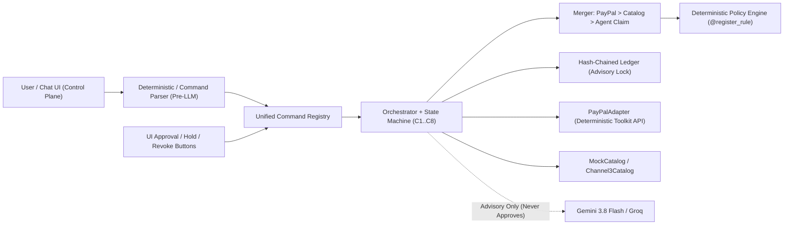

# Mandate Architecture

## Core Isolation Boundary

`packages/core/mandate_core/` has **zero** imports from `adapters/` or `apps/`. Every integration sits behind Python `Protocol` ports (`PaymentProvider`, `Catalog`, `LLM`, `Notifier`, `StateStore`).

## Checkpoints (C1–C8)

- **C1**: Proposal ingestion (`PROPOSED`)
- **C2**: Cart lock (`CART_LOCKED`)
- **C3**: Pre-approval card check (`CHECKED` -> `AWAITING_APPROVAL`)
- **C4**: Approve click (`APPROVED` or `NEEDS_RECONFIRM` / `BLOCKED`)
- **C5**: Pre-capture final gate — fresh Catalog + PayPal `get_order` merge; **VOID** immediately on mismatch (`PAYEE_MISMATCH` / `PRICE_DRIFT`)
- **C6**: ProofGuard post-capture comparison -> `VERIFIED` or `FLAGGED`
- **C7**: Background `recheck_jobs` sweep over `HELD` / `AUTHORIZED` cases (`FOR UPDATE SKIP LOCKED`)
- **C8**: PayPal webhook deduplication (`event_id`) + reconcile job
